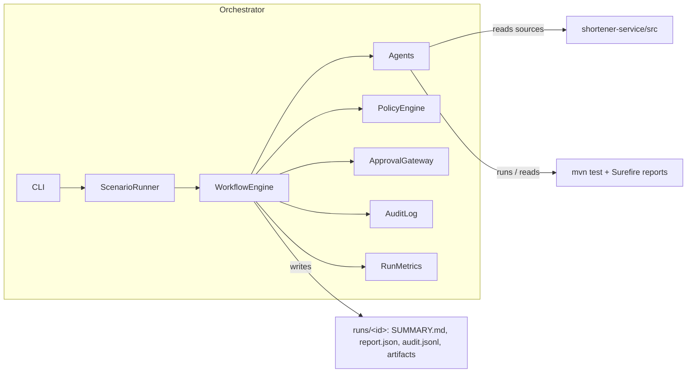
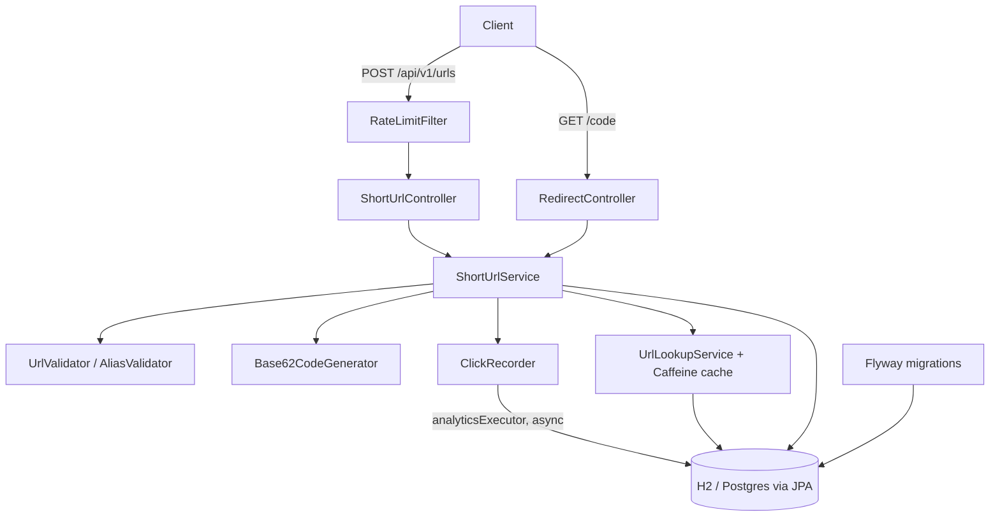
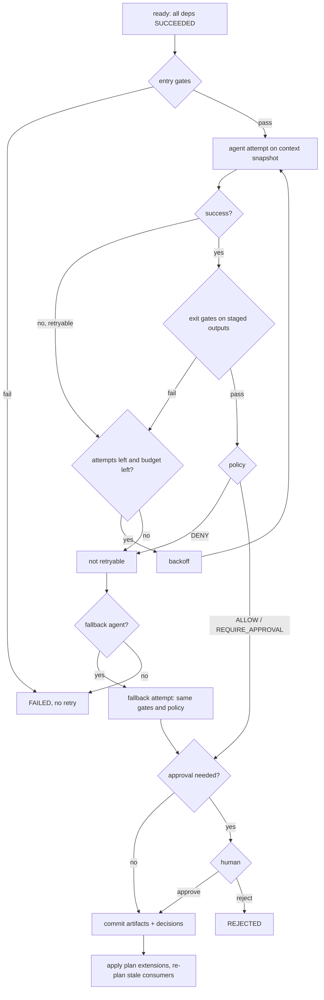
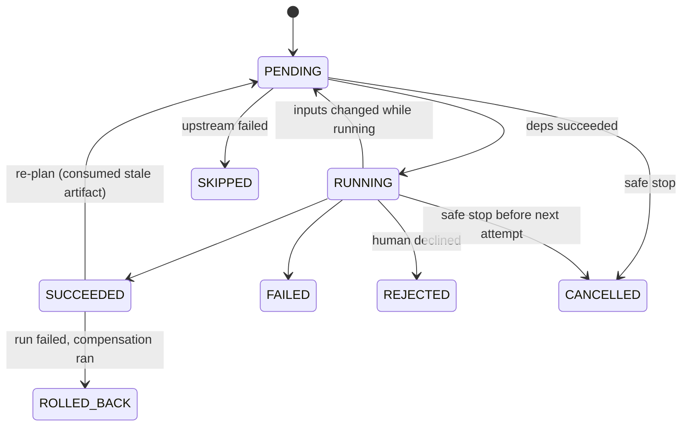

# Architecture

The repository holds two deliberately separate systems:

1. **`shortener-service`**: the product, a Spring Boot REST service.
2. **`orchestrator`**: the agentic SDLC system that plans, builds, validates and governs changes to that product.

They share a Maven parent but no code. The orchestrator reads the service's source tree (impact analysis) and its test reports (verification evidence), the way a real delivery pipeline treats the repository it works on.

---

## 1. Shortener service

### Components

| Package | Responsibility |
|---|---|
| `config` | `ShortenerProperties` (validated at startup), analytics executor, injectable `Clock`. |
| `domain` | `ShortUrl` and `ClickEvent` JPA entities. |
| `repository` | Spring Data repositories; the atomic click-count increment lives here. |
| `service` | Business rules: URL and alias validation, code allocation, expiry, de-duplication, stats, soft delete; cached lookup; async click recording. |
| `web` | Controllers, DTOs, RFC 7807 error mapping, rate-limit filter and token bucket. |

### Request flows

**Create** (`POST /api/v1/urls`): rate limit (per client token bucket) → bean validation → `UrlValidator` (scheme, host, private networks, self-reference, length, embedded credentials) → optional alias rules → if no alias and no expiry, reuse an existing permanent link for the same URL (idempotent) → otherwise generate a random Base62 code and insert; on a collision (pre-check or unique-constraint violation from a concurrent insert) retry with a fresh code, at most `max-generation-attempts` times, then answer 503.

**Redirect** (`GET /{code}`): cached lookup of `code → (id, target, expiresAt)` (Caffeine, 10k entries, 10 min) → 404 if unknown or deleted, 410 if expired → hand the click to `ClickRecorder` on a bounded executor → `302` with `Cache-Control: no-store`.

**Stats** (`GET /api/v1/urls/{code}/stats`): total from the counter column, per-day buckets for the last 30 days and top 5 referrers from `click_event`.

### Data model

Owned by Flyway (`V1__create_short_url_tables.sql`); Hibernate only validates (`ddl-auto: validate`).

| Table | Key columns | Notes |
|---|---|---|
| `short_url` | `code` UNIQUE, `original_url`, `custom_alias`, `created_at`, `expires_at`, `deleted_at`, `click_count`, `last_accessed_at`, `version` | Soft delete via `deleted_at`; `version` for optimistic locking on entity updates. Index on `original_url` for de-duplication. |
| `click_event` | `short_url_id` FK (cascade), `occurred_at`, `referrer`, `user_agent` | Index on `(short_url_id, occurred_at)` for stats. No IP address is stored. |

### Key decisions (service)

| Decision | Why | Trade-off accepted |
|---|---|---|
| **302 + `no-store`**, not 301 | Every click reaches the service, so analytics are complete and delete/expiry apply at once. | One extra round trip for repeat visitors. |
| **Random Base62 codes** (7 chars, 62^7 ≈ 3.5 × 10^12) | Not enumerable, so links cannot be scraped by counting; no central sequence to coordinate. | Rare collisions, handled by bounded retry backed by a unique constraint. |
| **Atomic SQL increment** for click counts | No lost updates under concurrent redirects, no optimistic-lock retries on the hot path. | Counter and event row are written in one small transaction. |
| **Async, best-effort analytics** | Redirect latency and availability matter more than perfect stats. Bounded queue with caller-runs: under overload, recording slows redirects instead of dropping events or exhausting memory. | A crash can lose the few events still queued. |
| **Cache only positive lookups** | New codes are visible immediately; deletes evict explicitly. | Expiry is checked on every hit, so a cached entry cannot outlive its expiry. |
| **De-duplicate permanent links** | Repeat submissions of the same URL do not grow the table; the API is idempotent for that case. | Aliased or expiring links are always new (they carry intent). |
| **Soft delete** | Keeps analytics history and guarantees a code is never handed to a different target. | Rows are never reclaimed (fine at this scale; a purge job is a follow-up). |
| **Validate, never fetch** the target | No SSRF surface; validation is fast and deterministic. | Cannot detect malicious content at the target (would need a reputation service). |
| **Rate-limit creation only** | Creation is the abuse vector (storage, spam); redirects are cheap and cached. | Per-node buckets; a cluster needs a shared store (Redis). |
| **Flyway owns the schema** | Reviewable, versioned, repeatable changes; the orchestrator's change-control policy builds on this. | Every schema change needs a new migration file. |

---

## 2. Orchestrator

### Components

| Component | Class(es) | Role |
|---|---|---|
| Plan | `WorkflowGraph`, `WorkflowNode` | Explicit DAG. Each node: stage, agent, optional fallback agent, dependencies, entry gates, exit gates, retry policy, impact level, compensation. Every mutation is validated (unknown deps, duplicates, cycles). |
| Engine | `WorkflowEngine`, `EngineConfig` | Schedules ready nodes in parallel, runs the per-node control loop, commits outputs, re-plans, rolls back, safe-stops. |
| Shared memory | `WorkflowContext`, `Artifact`, `DecisionRecord` | Versioned, content-hashed artifacts plus decision lineage. Agents get a snapshot; only the engine commits. |
| Agents | `agent.*` | One per stage: requirements, clarification, impact analysis, design, implementation, testing, security review, documentation, release readiness. Deterministic, behind the `Agent` interface. |
| Guardrails | `policy.*` | `SecretLeakRule`, `ChangeControlRule`, `PersonalDataRule`, `ReleaseComplianceRule`; verdicts ALLOW, REQUIRE_APPROVAL, DENY; fail closed. |
| Human in the loop | `ApprovalGateway` (`ConsoleApprovalGateway`, `ScriptedApprovalGateway`) | Approvals and clarifications. No answer, an exception or a missing script all mean "reject". |
| Observability | `AuditLog`, `RunMetrics`, `RunReport`, `ReportWriter` | Hash-chained JSONL audit trail, reliability metrics, `SUMMARY.md` + `report.json`. |
| Scenarios | `scenario.*` | The three assessment scenarios and their scripted humans. |

### Control flow of one node

Approval is needed when the node is HIGH impact or marked `requiresApproval`, when policy returns REQUIRE_APPROVAL, or when the agent itself escalates (`AgentResult.requestApproval`).

### Control flow of a run

1. Validate the DAG, record `RUN_STARTED` and the initial plan.
2. Loop: check stop conditions (kill switch file, deadline); schedule every PENDING node whose dependencies all SUCCEEDED, up to `maxParallelism`; wait for the next completed node; apply its outcome.
3. On **success**: commit artifacts (new version only if the content hash changed), record decisions with the artifact versions they were based on, apply plan extensions requested by the agent, and invalidate any node that consumed an older version of a changed artifact (plus everything downstream). A node that was still running when its inputs changed has its outputs discarded and is re-queued.
4. On **failure or rejection**: mark downstream nodes SKIPPED and stop scheduling (fail fast); let in-flight nodes finish.
5. After the loop: if failed, run compensations of completed nodes in reverse completion order; if stopped, mark remaining nodes CANCELLED and record `SAFE_STOP`.
6. Verify the audit chain, build the `RunReport`, write the run folder.

### Node state machine

### Threading model

A single **coordinator thread** owns all run state: node states, the graph, commits to the context, plan changes. **Worker threads** only execute agents against an immutable snapshot of the context and return a `NodeOutcome`. Consequences:

- Parallel branches need no locks around business state, and there are no partial commits.
- "Gates and policy before commit" cannot be bypassed: an agent has no write access to shared state.
- The versions recorded as consumed are exactly what the agent read, which makes re-planning precise.
- Audit and metrics are the only structures touched by workers; both are synchronized.

### Key decisions (orchestrator)

| Decision | Why |
|---|---|
| **Deterministic agents behind an interface** | Reproducible runs and testable governance. The engine is the subject of the assessment; an LLM-backed agent can implement `Agent` without engine changes, and would still be bound by the same gates, policy and approvals. |
| **Agents propose, the engine commits** | Every output passes exit gates, policy and (when needed) a human before anyone can depend on it. |
| **Content-hashed, versioned artifacts** | Change detection for re-planning, and lineage (`requirements@v2`) in every decision and audit event. |
| **Plan changes may only add work** | Agents can insert checks (e.g. a security review) and gate later nodes on them, but cannot remove nodes, edges or gates. This is the autonomy boundary for re-planning. |
| **Fail closed everywhere** | A throwing policy rule is a DENY; an unreachable human is a rejection; a missing script is a rejection; an audit write failure aborts the work instead of continuing unaudited. |
| **Safe stop instead of kill** | In-flight attempts finish, nothing new starts, state is preserved for a human. Rollback only runs on failure, not on stop, so an operator can inspect and decide. |
| **Hash-chained JSONL audit** | Append-only, greppable, and tamper-evident: editing, deleting or reordering a line breaks verification from that line on (`verify-audit`). |
| **Plain Java, no framework** | The orchestrator is a library and CLI; Spring would add startup cost and indirection without adding capability here. |
