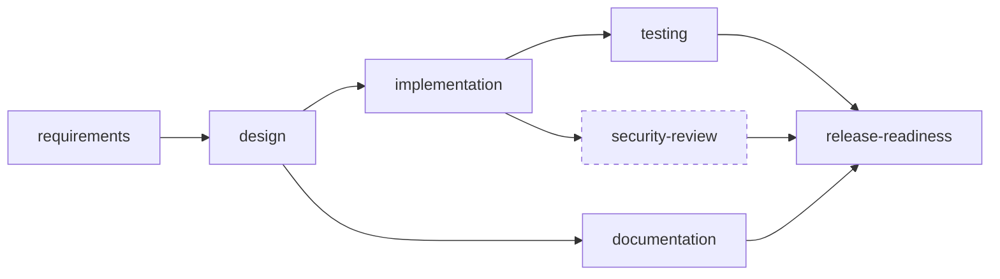
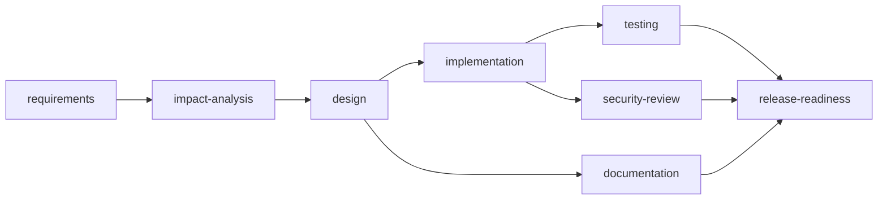
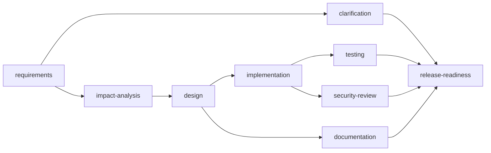

# Scenarios

The brief asks for three scenarios (greenfield, brownfield, ambiguous), each showing decomposition, orchestration and validation. All three are implemented in `orchestrator/src/main/java/com/urlshortener/orchestrator/scenario/` and run end to end:

```bash
mvn verify                                             # builds both modules and produces test evidence
java -jar orchestrator/target/orchestrator.jar run all # scripted human; add --interactive to approve yourself
```

The real output of that command is committed under [`sample-runs/`](sample-runs): one `SUMMARY.md` and one `audit.jsonl` per scenario. Numbers below come from those runs; timings vary per machine.

In unattended runs, a **scripted human** (`ScriptedApprovalGateway`) stands in for the approver. It is strict on purpose: anything it has no script for is rejected. `--interactive` replaces it with terminal prompts.

---

## 1. Greenfield: build the service

> Build a URL shortener service: shorten long URLs into short links, redirect short links to the original URL, support custom aliases and link expiry, provide click analytics (stats), allow deleting links, and rate limit link creation to prevent abuse.

### Decomposition

The requirements agent maps the wording to six capabilities, each with acceptance criteria (`create`, `redirect`, `analytics`, `expiry`, `alias`, `delete`), adds the rate-limiting NFR, and finds no vague terms, so there are no open questions.

Initial plan (6 nodes), extended at run time to 7:



`security-review` (dashed) does not exist in the initial plan. The design agent inserts it because the design exposes a public write endpoint, and gates `release-readiness` on it.

### Orchestration

| Step | What happens |
|---|---|
| requirements | Exit gate: `requirements` must contain `AC-1` (at least one acceptance criterion). |
| design | Entry gate: `requirements` exists. Exit gate: `design` has an `## API contract`. Emits a `PlanChange` (security review). |
| implementation ∥ documentation | Run in parallel. The change set adds `pom.xml`, `application.yml` and a `V1` migration, so change-control policy requires approval; the scripted tech lead approves. |
| testing ∥ security-review | Testing is wrapped in a fault injector: the first attempt fails with a simulated transient error ("test JVM fork crashed"), the retry succeeds and reads the Surefire evidence (49 tests, 0 failures). |
| release-readiness | Joins all branches. HIGH impact and release policy both require a sign-off; evidence checks pass; approved. |

### Validation

- Test evidence is the real Surefire output of `shortener-service` (`test-report`: `status: PASSED`).
- Security review checks five controls (URL validation, rate limiting, non-enumerable codes, no personal data, explicit errors) and secret-scans every artifact.
- Release compliance policy verifies tests, docs, requirements and security review before even asking for the sign-off.

**Result:** SUCCEEDED; 8 attempts, 1 retry, 1 plan extension, 2 approvals, MTTR around 70 ms (the transient failure). See [`sample-runs/greenfield/SUMMARY.md`](sample-runs/greenfield/SUMMARY.md).

---

## 2. Brownfield: add a per-link click limit

> Enhance the existing shortener: add a click limit so the owner can set maxClicks when creating a short link. Once the limit is reached the link stops redirecting and returns 410 Gone. Expose remaining clicks in stats.

### Decomposition

Requirements: `create`, `redirect`, `analytics` (already exist) and `click-cap` (new: `maxClicks` on create, 410 once reached, remaining clicks in stats).



### Codebase reasoning

`ImpactAnalysisAgent` reads the actual `shortener-service/src` tree:

- It decides which capabilities are new by checking whether their code symbols already exist: `create`, `redirect` and `analytics` are fully present, `click-cap` is not (`maxClicks` is missing).
- It searches for the existing symbols the new capability builds on (`clickCount`, `incrementClicks`, `resolveForRedirect`, `ShortUrl`, `ResolvedUrl`, `CreateShortUrlRequest`, `UrlStatsResponse`, ...) with whole-identifier matching.
- Output: 14 impacted files grouped by layer (domain, repository, schema, service, web, tests), the impacted endpoints parsed from the controllers, the create and redirect data flows, the latest migration (`V1`) and therefore the next one (`V2`), and risks: the redirect hot path, migration immutability, and the cached `ResolvedUrl` needing the new field.

### Orchestration

| Step | What happens |
|---|---|
| implementation (primary) | `ImplementationAgent(IN_PLACE_SCHEMA_EDIT)` proposes `MODIFY .../V1__create_short_url_tables.sql`. Change-control policy returns **DENY** ("applied migrations are immutable"). DENY is not retryable, so the outputs are discarded. |
| implementation (fallback) | `ImplementationAgent(ADDITIVE_MIGRATION)` proposes `ADD .../V2__add_max_clicks.sql` plus the impacted files and a new test. Policy returns REQUIRE_APPROVAL for the schema change; the scripted service owner approves. |
| testing ∥ security-review ∥ documentation | Regression evidence from the current suite, threat review, docs including the impact section. |
| release-readiness | Evidence verified, signed off. |

### Validation

- The denial, the fallback and the approval are all in the audit trail (`POLICY_DENIED`, `FALLBACK_STARTED`, `APPROVAL_GRANTED`).
- The committed change set contains `ADD ...V2__add_max_clicks.sql` and no modification of `V1` (asserted in `ScenarioIntegrationTest`).
- Test evidence here is **regression evidence for the current codebase**: the implementation agent proposes the change, it does not write the Java code (see limitations).

**Result:** SUCCEEDED; 1 policy denial, 1 fallback, 2 approvals. See [`sample-runs/brownfield/SUMMARY.md`](sample-runs/brownfield/SUMMARY.md).

---

## 3. Ambiguous: "faster, more reliable, better analytics"

> Make the short links faster and more reliable, and give us better analytics.

### Decomposition

The requirements agent matches `create` and `analytics`, and flags three vague terms with a question and a default assumption each:

| Term | Question | Default assumption |
|---|---|---|
| fast | What latency target should redirects meet? | p99 under 50 ms at 200 req/s on one node |
| reliable | What availability target applies, and which failures must never affect users? | 99.9%; analytics must never break a redirect |
| better | Which specific metrics or behaviours are missing today? | Per-day clicks and top referrers; no personal data |

Rather than block, the plan proceeds optimistically on the documented assumptions while the human is asked in parallel:



### Orchestration

| Step | What happens |
|---|---|
| clarification ∥ impact-analysis (v1) | Both start from `requirements@v1`. Impact analysis finds nothing new (everything in v1 already exists) and escalates: "requirement appears to be already implemented; confirm". The clarification agent asks the three questions. |
| clarification answers | The product owner answers: p99 under 20 ms at 500 req/s; 99.95% with redirects surviving an analytics outage; **unique visitors per day, hashing the client IP with a daily rotating salt, never storing raw IPs, 30-day retention**. The analyser re-runs with the answers, adds the `unique-visitors` capability and produces `requirements@v2` with no open questions. |
| re-plan | Commit of `requirements@v2` changes content, so the engine records one `REPLANNED` event and invalidates every node that read v1. If impact analysis already finished it goes back to pending (with everything downstream); if it is still running, its outputs are discarded when it finishes. Either way it re-runs on v2. |
| impact-analysis (v2) | Now finds a new capability (`visitorHash` does not exist) and 8 impacted files around `ClickEvent`, `ClickRecorder`, `UrlStatsResponse` and `click_event`. |
| design | Adds `click_event.visitor_hash` (salted hash, raw IP never persisted, purged after retention). Because the design processes personal data, it inserts a security review. Personal-data policy sees retention and anonymisation, so no extra approval is needed. |
| implementation | Additive `V2__add_visitor_hash.sql`; schema approval. |
| release-readiness | Waits for clarification as well as testing, docs and security review; signed off. |

### Validation

- `requirements` ends at v2 with the clarifications recorded; `open-questions` is `none`.
- Decision lineage shows the pivot: early decisions are based on `requirements@v1`, later ones on `requirements@v2` and `clarifications@v1`.
- `ScenarioIntegrationTest.ambiguousWithoutAnswersNeedsSignOffOnAssumptions` covers the other branch: if nobody answers, the clarification agent asks for sign-off on proceeding with assumptions, and an absent approver means the run fails safely before release.

**Result:** SUCCEEDED; 1 re-plan, 1 plan extension, 3 approvals plus the clarification exchange. See [`sample-runs/ambiguous/SUMMARY.md`](sample-runs/ambiguous/SUMMARY.md).

---

## Failure demonstrations

Any scenario can be pushed down a failure path from the CLI:

| Command | Outcome |
|---|---|
| `run greenfield --fail testing` | testing FAILED, release SKIPPED, implementation ROLLED_BACK (branch discarded). Status FAILED. |
| `run greenfield --reject release-readiness` | release REJECTED by the human, implementation ROLLED_BACK. Status FAILED. |
| `run greenfield --tests plan` | No test evidence (`status: NOT_RUN`); release policy DENY. Status FAILED. |
| `run greenfield --max-attempts 3` | Attempt budget exhausted; testing and release CANCELLED. Status STOPPED (no rollback). |
| `touch .orchestrator/STOP` during a run | Kill switch; same safe-stop behaviour. |
| `verify-audit` on an edited `audit.jsonl` | "audit chain BROKEN at event #n". |
