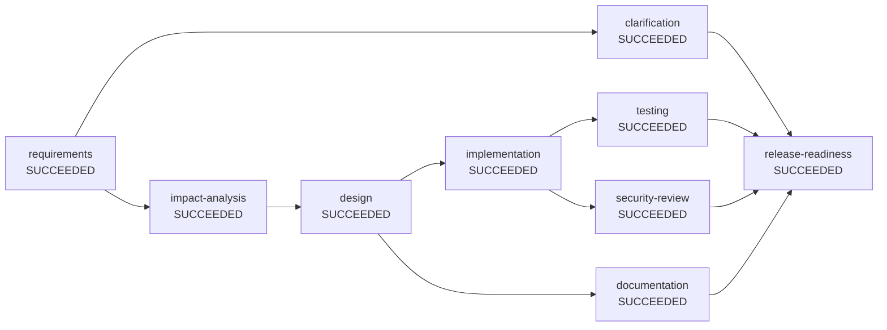

# Engineering summary: ambiguous

| | |
|---|---|
| Run | `ambiguous-c97abb75` |
| Status | **SUCCEEDED** |
| Plan revision | 3 |
| Audit chain | intact, 79 events (`audit.jsonl`) |

## Requirement

> Make the short links faster and more reliable, and give us better analytics.

## Plan (final dependency graph)

Nodes on the same level have no dependency on each other and ran in parallel.

- Level 0: requirements
- Level 1: clarification, impact-analysis
- Level 2: design
- Level 3: implementation, documentation
- Level 4: testing, security-review
- Level 5: release-readiness

## Execution

| Node | Stage | Impact | State | Attempts | Runs | Agent | Time (ms) | Outcome |
|---|---|---|---|---|---|---|---|---|
| requirements | REQUIREMENTS | LOW | SUCCEEDED | 1 | 1 | requirements-agent | 2 | 2 functional requirements, 3 open questions |
| clarification | CLARIFICATION | LOW | SUCCEEDED | 1 | 1 | clarification-agent | 11 | 3 questions answered; requirements updated |
| impact-analysis | IMPACT_ANALYSIS | LOW | SUCCEEDED | 2 | 2 | impact-analysis-agent | 39 | 8 files impacted across [domain, repository, schema, service, tests, web] |
| design | DESIGN | LOW | SUCCEEDED | 1 | 1 | design-agent | 0 | design for [create, redirect, analytics, unique-visitors] |
| implementation | IMPLEMENTATION | MEDIUM | SUCCEEDED | 1 | 1 | implementation-agent(additive-migration) | 1 | 9 file changes proposed (ADDITIVE_MIGRATION) |
| documentation | DOCUMENTATION | LOW | SUCCEEDED | 1 | 1 | documentation-agent | 6 | documentation assembled |
| testing | TESTING | LOW | SUCCEEDED | 1 | 1 | test-agent(reports) | 2 | 49 tests passed |
| security-review | SECURITY_REVIEW | MEDIUM | SUCCEEDED | 1 | 1 | security-review-agent | 2 | security review passed (5 controls) |
| release-readiness | RELEASE_READINESS | HIGH | SUCCEEDED | 1 | 1 | release-readiness-agent | 1 | release candidate ready (GO) |

## Reliability metrics

| Metric | Value |
|---|---|
| Success rate | 100% |
| Attempts / retries | 10 / 0 |
| Fallbacks | 0 |
| Rollbacks | 0 |
| Re-plans / plan extensions | 1 / 1 |
| Approvals requested / rejected | 3 / 0 |
| Policy denials | 0 |
| MTTR (recovered nodes) | n/a |
| End-to-end latency | 63 ms |

## Human oversight

- **clarification**: clarify requirements -> approved by product-owner (scripted) ("clarifications provided")
  - reason: requirement contains ambiguous terms
  - Q: [reliable] What availability target applies, and which failures must never affect users?
    A: 99.95% availability; redirects must keep working when analytics storage is down
  - Q: [fast] What latency target should redirects meet (for example p99 under 50 ms)?
    A: p99 redirect latency under 20 ms at 500 req/s
  - Q: [better] Which specific metrics or behaviours are missing today?
    A: Show unique visitors per day. Hash the client IP with a daily rotating salt, never store raw IPs, 30-day retention for hashes.
- **impact-analysis**: accept outputs of impact-analysis -> approved by product-owner (scripted) ("confirmed: continue while clarification is pending")
  - reason: requirement appears to be already implemented; confirm before continuing
- **implementation**: accept outputs of implementation -> approved by product-owner (scripted) ("additive migration for visitor_hash reviewed")
  - reason: [CHG-001-change-control] schema change shortener-service/src/main/resources/db/migration/V2__add_visitor_hash.sql needs DBA/owner approval
- **release-readiness**: accept outputs of release-readiness -> approved by product-owner (scripted) ("clarified scope delivered; GO")
  - reason: node is HIGH impact and requires sign-off
  - reason: [CMP-002-release-evidence] release candidates always need a human sign-off

## Policy guardrails

- `REQUIRE_APPROVAL` CHG-001-change-control (CHANGE_CONTROL) on `changeset`: schema change shortener-service/src/main/resources/db/migration/V2__add_visitor_hash.sql needs DBA/owner approval
- `REQUIRE_APPROVAL` CMP-002-release-evidence (COMPLIANCE) on `release-checklist`: release candidates always need a human sign-off

## Decision lineage

- **D1** [requirements, plan rev 1] Scope normalised to capabilities [create, analytics]
  - why: Matched requirement wording against the domain capability catalogue; each capability brings testable acceptance criteria
  - based on: original requirement
- **D2** [requirements, plan rev 1] Proceed optimistically on 3 documented assumptions
  - why: Design can start in parallel with clarification; if answers change the requirements the engine re-plans downstream work
  - based on: original requirement
- **D3** [clarification, plan rev 1] Requirements revised with clarified terms [reliable, fast, better]
  - why: Human answers replace default assumptions; downstream work based on the old version is now stale
  - based on: open-questions@v1, requirements@v1
- **D4** [impact-analysis, plan rev 2] Change confined to layers [domain, repository, schema, service, tests, web]
  - why: Static scan of shortener-service for symbols the new capabilities build on
  - based on: clarifications@v1, open-questions@v2, requirements@v2
- **D5** [design, plan rev 2] Layered Spring Boot service with cached redirect path and async analytics
  - why: Redirect latency and availability dominate; analytics can lag without user impact
  - based on: clarifications@v1, impact-analysis@v1, open-questions@v2, requirements@v2
- **D6** [design, plan rev 2] Inserted security review before release
  - why: Personal data handling must be reviewed
  - based on: clarifications@v1, impact-analysis@v1, open-questions@v2, requirements@v2
- **D7** [implementation, plan rev 3] Change set derived from impact analysis using ADDITIVE_MIGRATION
  - why: Additive migration is safe for environments where V1 is already applied
  - based on: clarifications@v1, design@v1, impact-analysis@v1, open-questions@v2, requirements@v2
- **D8** [testing, plan rev 3] Accepted test evidence: 49 tests, 0 failures
  - why: Surefire reports from mode REPORTS are the verification of record
  - based on: changeset@v1, clarifications@v1, design@v1, impact-analysis@v1, implementation-plan@v1, open-questions@v2, requirements@v2
- **D9** [documentation, plan rev 3] Docs generated from requirements, design and impact artifacts
  - why: Generated from the same artifacts reviewers approved, so docs cannot drift from the plan
  - based on: clarifications@v1, design@v1, impact-analysis@v1, open-questions@v2, requirements@v2
- **D10** [security-review, plan rev 3] Security review passed
  - why: All required controls present in the design; no secrets in artifacts
  - based on: changeset@v1, clarifications@v1, design@v1, impact-analysis@v1, implementation-plan@v1, open-questions@v2, requirements@v2
- **D11** [release-readiness, plan rev 3] Recommend GO
  - why: 0 checklist items open
  - based on: changeset@v1, clarifications@v1, design@v1, documentation@v1, impact-analysis@v1, implementation-plan@v1, open-questions@v2, requirements@v2, security-review@v1, test-plan@v1, test-report@v1

## Artifacts

| Artifact | Version | Produced by | SHA-256 |
|---|---|---|---|
| changeset | v1 | implementation | `c39c50e97f47` |
| clarifications | v1 | clarification | `c566c32eeb1e` |
| design | v1 | design | `077acf8a98b1` |
| documentation | v1 | documentation | `2fd9a8671133` |
| impact-analysis | v1 | impact-analysis | `a6a41defdc9a` |
| implementation-plan | v1 | implementation | `ae6829ae743b` |
| open-questions | v2 | clarification | `fcf33dfbe13c` |
| release-checklist | v1 | release-readiness | `f7ce2407a742` |
| release-notes | v1 | release-readiness | `724a23d72e50` |
| requirements | v2 | clarification | `ca74aa5b85bf` |
| security-review | v1 | security-review | `769f8ed5a37b` |
| test-plan | v1 | testing | `f2084516ac4c` |
| test-report | v1 | testing | `9f55f6b75493` |

Every version is saved under `artifacts/`.

## Assumptions

None.

## Limitations of this run

- Agents are deterministic and rule-based (no LLM call); the `Agent` interface is the seam for one.
- The implementation agent proposes a change set and plan; it does not edit source files.
- Test evidence is only as strong as the configured test mode (see `test-report`).
