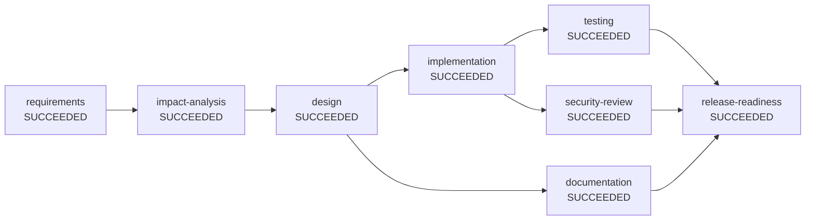

# Engineering summary: brownfield

| | |
|---|---|
| Run | `brownfield-50552474` |
| Status | **SUCCEEDED** |
| Plan revision | 2 |
| Audit chain | intact, 66 events (`audit.jsonl`) |

## Requirement

> Enhance the existing shortener: add a click limit so the owner can set maxClicks when creating a short link. Once the limit is reached the link stops redirecting and returns 410 Gone. Expose remaining clicks in stats.

## Plan (final dependency graph)

Nodes on the same level have no dependency on each other and ran in parallel.

- Level 0: requirements
- Level 1: impact-analysis
- Level 2: design
- Level 3: implementation, documentation
- Level 4: testing, security-review
- Level 5: release-readiness

## Execution

| Node | Stage | Impact | State | Attempts | Runs | Agent | Time (ms) | Outcome |
|---|---|---|---|---|---|---|---|---|
| requirements | REQUIREMENTS | LOW | SUCCEEDED | 1 | 1 | requirements-agent | 2 | 4 functional requirements, 0 open questions |
| impact-analysis | IMPACT_ANALYSIS | LOW | SUCCEEDED | 1 | 1 | impact-analysis-agent | 72 | 14 files impacted across [domain, repository, schema, service, tests, web] |
| design | DESIGN | LOW | SUCCEEDED | 1 | 1 | design-agent | 2 | design for [create, redirect, analytics, click-cap] |
| implementation | IMPLEMENTATION | MEDIUM | SUCCEEDED | 2 | 1 | implementation-agent(additive-migration) | 9 | 15 file changes proposed (ADDITIVE_MIGRATION) |
| documentation | DOCUMENTATION | LOW | SUCCEEDED | 1 | 1 | documentation-agent | 2 | documentation assembled |
| testing | TESTING | LOW | SUCCEEDED | 1 | 1 | test-agent(reports) | 3 | 49 tests passed |
| security-review | SECURITY_REVIEW | MEDIUM | SUCCEEDED | 1 | 1 | security-review-agent | 4 | security review passed (5 controls) |
| release-readiness | RELEASE_READINESS | HIGH | SUCCEEDED | 1 | 1 | release-readiness-agent | 1 | release candidate ready (GO) |

## Reliability metrics

| Metric | Value |
|---|---|
| Success rate | 100% |
| Attempts / retries | 9 / 0 |
| Fallbacks | 1 |
| Rollbacks | 0 |
| Re-plans / plan extensions | 0 / 1 |
| Approvals requested / rejected | 2 / 0 |
| Policy denials | 1 |
| MTTR (recovered nodes) | 4 ms over 1 recovered node(s) |
| End-to-end latency | 105 ms |

## Human oversight

- **implementation**: accept outputs of implementation -> approved by service-owner (scripted) ("additive migration V2 reviewed; nullable column, no backfill needed")
  - reason: [CHG-001-change-control] schema change shortener-service/src/main/resources/db/migration/V2__add_max_clicks.sql needs DBA/owner approval
- **release-readiness**: accept outputs of release-readiness -> approved by service-owner (scripted) ("regression suite green; GO")
  - reason: node is HIGH impact and requires sign-off
  - reason: [CMP-002-release-evidence] release candidates always need a human sign-off

## Policy guardrails

- `DENY` CHG-001-change-control (CHANGE_CONTROL) on `changeset`: MODIFY shortener-service/src/main/resources/db/migration/V1__create_short_url_tables.sql: applied migrations are immutable, add a new V<n>__ migration
- `REQUIRE_APPROVAL` CHG-001-change-control (CHANGE_CONTROL) on `changeset`: schema change shortener-service/src/main/resources/db/migration/V2__add_max_clicks.sql needs DBA/owner approval
- `REQUIRE_APPROVAL` CMP-002-release-evidence (COMPLIANCE) on `release-checklist`: release candidates always need a human sign-off

## Decision lineage

- **D1** [requirements, plan rev 1] Scope normalised to capabilities [create, redirect, analytics, click-cap]
  - why: Matched requirement wording against the domain capability catalogue; each capability brings testable acceptance criteria
  - based on: original requirement
- **D2** [impact-analysis, plan rev 1] Change confined to layers [domain, repository, schema, service, tests, web]
  - why: Static scan of shortener-service for symbols the new capabilities build on
  - based on: open-questions@v1, requirements@v1
- **D3** [design, plan rev 1] Layered Spring Boot service with cached redirect path and async analytics
  - why: Redirect latency and availability dominate; analytics can lag without user impact
  - based on: impact-analysis@v1, open-questions@v1, requirements@v1
- **D4** [design, plan rev 1] Inserted security review before release
  - why: Public write endpoints are an abuse surface
  - based on: impact-analysis@v1, open-questions@v1, requirements@v1
- **D5** [documentation, plan rev 2] Docs generated from requirements, design and impact artifacts
  - why: Generated from the same artifacts reviewers approved, so docs cannot drift from the plan
  - based on: design@v1, impact-analysis@v1, open-questions@v1, requirements@v1
- **D6** [implementation, plan rev 2] Change set derived from impact analysis using ADDITIVE_MIGRATION
  - why: Additive migration is safe for environments where V1 is already applied
  - based on: design@v1, impact-analysis@v1, open-questions@v1, requirements@v1
- **D7** [testing, plan rev 2] Accepted test evidence: 49 tests, 0 failures
  - why: Surefire reports from mode REPORTS are the verification of record
  - based on: changeset@v1, design@v1, documentation@v1, impact-analysis@v1, implementation-plan@v1, open-questions@v1, requirements@v1
- **D8** [security-review, plan rev 2] Security review passed
  - why: All required controls present in the design; no secrets in artifacts
  - based on: changeset@v1, design@v1, documentation@v1, impact-analysis@v1, implementation-plan@v1, open-questions@v1, requirements@v1
- **D9** [release-readiness, plan rev 2] Recommend GO
  - why: 0 checklist items open
  - based on: changeset@v1, design@v1, documentation@v1, impact-analysis@v1, implementation-plan@v1, open-questions@v1, requirements@v1, security-review@v1, test-plan@v1, test-report@v1

## Artifacts

| Artifact | Version | Produced by | SHA-256 |
|---|---|---|---|
| changeset | v1 | implementation | `113b24f9a1bc` |
| design | v1 | design | `40c42375e706` |
| documentation | v1 | documentation | `ba80e84063e1` |
| impact-analysis | v1 | impact-analysis | `c617b0d643d7` |
| implementation-plan | v1 | implementation | `115d33d0e9d2` |
| open-questions | v1 | requirements | `fcf33dfbe13c` |
| release-checklist | v1 | release-readiness | `f7ce2407a742` |
| release-notes | v1 | release-readiness | `1a62ed6c9337` |
| requirements | v1 | requirements | `b1f2d59ad70c` |
| security-review | v1 | security-review | `53f3c7f20637` |
| test-plan | v1 | testing | `fc66001882ad` |
| test-report | v1 | testing | `9f55f6b75493` |

Every version is saved under `artifacts/`.

## Assumptions

None.

## Limitations of this run

- Agents are deterministic and rule-based (no LLM call); the `Agent` interface is the seam for one.
- The implementation agent proposes a change set and plan; it does not edit source files.
- Test evidence is only as strong as the configured test mode (see `test-report`).
