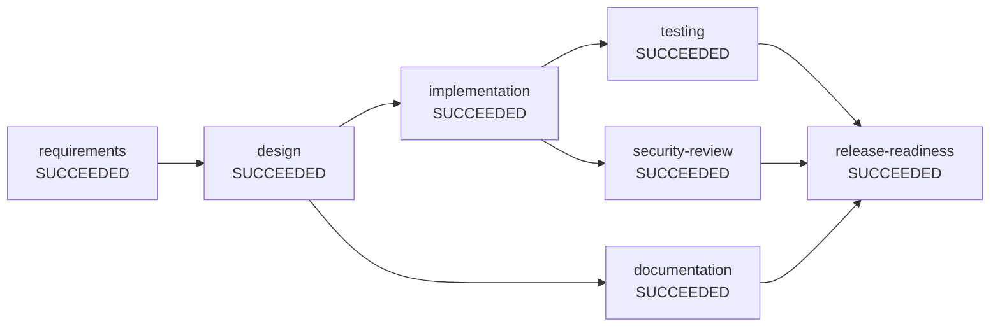

# Engineering summary: greenfield

| | |
|---|---|
| Run | `greenfield-09db51df` |
| Status | **SUCCEEDED** |
| Plan revision | 2 |
| Audit chain | intact, 58 events (`audit.jsonl`) |

## Requirement

> Build a URL shortener service: shorten long URLs into short links, redirect short links to the original URL, support custom aliases and link expiry, provide click analytics (stats), allow deleting links, and rate limit link creation to prevent abuse.

## Plan (final dependency graph)

Nodes on the same level have no dependency on each other and ran in parallel.

- Level 0: requirements
- Level 1: design
- Level 2: implementation, documentation
- Level 3: testing, security-review
- Level 4: release-readiness

## Execution

| Node | Stage | Impact | State | Attempts | Runs | Agent | Time (ms) | Outcome |
|---|---|---|---|---|---|---|---|---|
| requirements | REQUIREMENTS | LOW | SUCCEEDED | 1 | 1 | requirements-agent | 26 | 6 functional requirements, 0 open questions |
| design | DESIGN | LOW | SUCCEEDED | 1 | 1 | design-agent | 8 | design for [create, redirect, analytics, expiry, alias, delete] |
| implementation | IMPLEMENTATION | MEDIUM | SUCCEEDED | 1 | 1 | implementation-agent(additive-migration) | 12 | 20 files in change set |
| documentation | DOCUMENTATION | LOW | SUCCEEDED | 1 | 1 | documentation-agent | 12 | documentation assembled |
| testing | TESTING | LOW | SUCCEEDED | 2 | 1 | test-agent(reports) | 72 | 49 tests passed |
| security-review | SECURITY_REVIEW | MEDIUM | SUCCEEDED | 1 | 1 | security-review-agent | 8 | security review passed (5 controls) |
| release-readiness | RELEASE_READINESS | HIGH | SUCCEEDED | 1 | 1 | release-readiness-agent | 3 | release candidate ready (GO) |

## Reliability metrics

| Metric | Value |
|---|---|
| Success rate | 100% |
| Attempts / retries | 8 / 1 |
| Fallbacks | 0 |
| Rollbacks | 0 |
| Re-plans / plan extensions | 0 / 1 |
| Approvals requested / rejected | 2 / 0 |
| Policy denials | 0 |
| MTTR (recovered nodes) | 71 ms over 1 recovered node(s) |
| End-to-end latency | 241 ms |

## Human oversight

- **implementation**: accept outputs of implementation -> approved by tech-lead (scripted) ("scaffolding, build files and V1 schema reviewed")
  - reason: [CHG-001-change-control] ADD of protected path pom.xml
  - reason: [CHG-001-change-control] ADD of protected path shortener-service/pom.xml
  - reason: [CHG-001-change-control] ADD of protected path shortener-service/src/main/resources/application.yml
  - reason: [CHG-001-change-control] schema change shortener-service/src/main/resources/db/migration/V1__create_short_url_tables.sql needs DBA/owner approval
- **release-readiness**: accept outputs of release-readiness -> approved by tech-lead (scripted) ("evidence reviewed; GO for release candidate")
  - reason: node is HIGH impact and requires sign-off
  - reason: [CMP-002-release-evidence] release candidates always need a human sign-off

## Policy guardrails

- `REQUIRE_APPROVAL` CHG-001-change-control (CHANGE_CONTROL) on `changeset`: ADD of protected path pom.xml
- `REQUIRE_APPROVAL` CHG-001-change-control (CHANGE_CONTROL) on `changeset`: ADD of protected path shortener-service/pom.xml
- `REQUIRE_APPROVAL` CHG-001-change-control (CHANGE_CONTROL) on `changeset`: ADD of protected path shortener-service/src/main/resources/application.yml
- `REQUIRE_APPROVAL` CHG-001-change-control (CHANGE_CONTROL) on `changeset`: schema change shortener-service/src/main/resources/db/migration/V1__create_short_url_tables.sql needs DBA/owner approval
- `REQUIRE_APPROVAL` CMP-002-release-evidence (COMPLIANCE) on `release-checklist`: release candidates always need a human sign-off

## Decision lineage

- **D1** [requirements, plan rev 1] Scope normalised to capabilities [create, redirect, analytics, expiry, alias, delete]
  - why: Matched requirement wording against the domain capability catalogue; each capability brings testable acceptance criteria
  - based on: original requirement
- **D2** [design, plan rev 1] Layered Spring Boot service with cached redirect path and async analytics
  - why: Redirect latency and availability dominate; analytics can lag without user impact
  - based on: open-questions@v1, requirements@v1
- **D3** [design, plan rev 1] Inserted security review before release
  - why: Public write endpoints are an abuse surface
  - based on: open-questions@v1, requirements@v1
- **D4** [implementation, plan rev 2] Greenfield layout: config / domain / repository / service / web
  - why: Conventional Spring layering keeps each concern unit-testable and easy to review
  - based on: design@v1, open-questions@v1, requirements@v1
- **D5** [documentation, plan rev 2] Docs generated from requirements, design and impact artifacts
  - why: Generated from the same artifacts reviewers approved, so docs cannot drift from the plan
  - based on: design@v1, open-questions@v1, requirements@v1
- **D6** [security-review, plan rev 2] Security review passed
  - why: All required controls present in the design; no secrets in artifacts
  - based on: changeset@v1, design@v1, implementation-plan@v1, open-questions@v1, requirements@v1
- **D7** [testing, plan rev 2] Accepted test evidence: 49 tests, 0 failures
  - why: Surefire reports from mode REPORTS are the verification of record
  - based on: changeset@v1, design@v1, implementation-plan@v1, open-questions@v1, requirements@v1
- **D8** [release-readiness, plan rev 2] Recommend GO
  - why: 0 checklist items open
  - based on: changeset@v1, design@v1, documentation@v1, implementation-plan@v1, open-questions@v1, requirements@v1, security-review@v1, test-plan@v1, test-report@v1

## Artifacts

| Artifact | Version | Produced by | SHA-256 |
|---|---|---|---|
| changeset | v1 | implementation | `a6aa8b2c0b86` |
| design | v1 | design | `0eed98788265` |
| documentation | v1 | documentation | `be5de464dc92` |
| implementation-plan | v1 | implementation | `4f30d436124e` |
| open-questions | v1 | requirements | `fcf33dfbe13c` |
| release-checklist | v1 | release-readiness | `f7ce2407a742` |
| release-notes | v1 | release-readiness | `a2dfff1a5b15` |
| requirements | v1 | requirements | `132d84cbb768` |
| security-review | v1 | security-review | `93b48212f53e` |
| test-plan | v1 | testing | `98f7d0f768dd` |
| test-report | v1 | testing | `9f55f6b75493` |

Every version is saved under `artifacts/`.

## Assumptions

None.

## Limitations of this run

- Agents are deterministic and rule-based (no LLM call); the `Agent` interface is the seam for one.
- The implementation agent proposes a change set and plan; it does not edit source files.
- Test evidence is only as strong as the configured test mode (see `test-report`).
